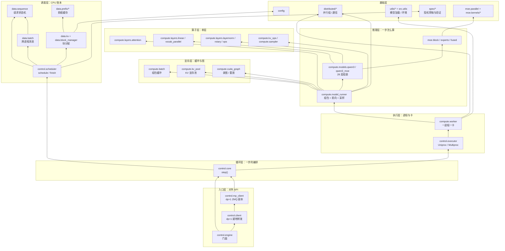
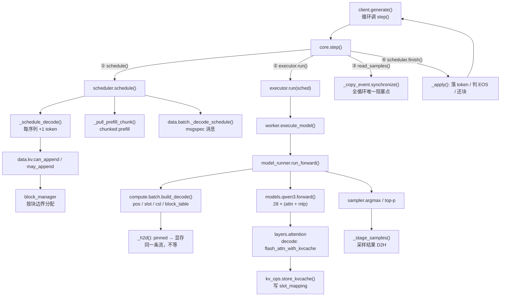

# 08 文件依赖图与逐行阅读路径

这份文档解决两个问题：

1. **谁依赖谁** —— §1 功能分层图、§2 一次 decode step 的调用链、§6 全量依赖表（产品代码 71 个模块 / 13190 行，机械扫描得出）。
2. **按什么顺序读** —— §4 的十二站路径，每站都写了「读完要能回答什么」，答不上来就别往下走。

> 两张图是手画的（表达设计意图），§6 的表格和层号是算出来的（`tools/dep_graph.py` 用 ast 扫 import、Tarjan 求环、按最长路径分层）。
> 两者层号不一致是正常的：表格里的层号会被 `__init__.py` 的重导出抬高（一个包只要 `from .x import Y`，它就在 `x` 之上）。
> 改完代码重跑 `python3 tools/gen_dep_doc.py` 刷新表格，别手改生成物。

## 0. 一分钟版

```
入口             src/control/engine.py               Engine（门面：add_request / generate / abort）
  └─ 客户端      src/control/client.py               dp=1 就地转发
     └─ 多进程   src/control/mp_client.py            dp>1 时 ZMQ 副本 + 后台 core 进程
        └─ 核心循环 src/control/core.py              step(): 调度 → 发射 → 取结果 → 回灌
             ├─ 调度 src/control/scheduler.py        schedule() / finish()
             │   └─ 账本 src/data/{sequence,kv,block_manager,batch,prefix/*}.py
             ├─ 执行 src/control/executor.py         单卡直调 / 多卡 rank0 广播
             │   └─ 单卡 src/compute/worker.py
             │       └─ src/compute/model_runner.py  组包 + 前向 + 采样（+ CUDA Graph / compile）
             │            ├─ src/compute/batch.py    CPU 张量 → pinned → 显存
             │            ├─ src/compute/models/*    28 层怎么组装
             │            └─ src/compute/layers/*    单层算子
             └─ 显存 src/compute/kv_pool.py         真实 KV 显存池
```

一句话记住分层：**control 不碰张量，compute 不碰调度**；`data/` 是两边共用的 CPU 侧结构；`distributed/` 只在建进程时被执行到。

## 1. 功能分层图

按"职责"分层，不是按目录。箭头方向 = 依赖方向（下层不反向依赖上层，这条由 §6 的机械扫描保证）。



**怎么用这张图**：想把某段逻辑改掉，先在图上定位它在哪层，再看 §3 的反向索引找到具体文件；
读代码时如果发现下层在 import 上层，那一定是延迟 import 或在破环（§5 坑 2）。

机器统计的分层规模（层号由 import 关系算出，会被 `__init__` 重导出抬高，与上图的分组不必一一对应）：

| 层 | 模块数 | 行数 | 内容 |
|---|---|---|---|
| L0 | 27 | 3941 | 叶子：配置、块管理、采样/写 KV 的 kernel、分布式基础、MoE 与投机的底层核、`utils/` |
| L1 | 14 | 1418 | 单层算子（attention/layernorm）、包级 `__init__`、loader/shim、通信与 Triton MoE |
| L2 | 8 | 1165 | 调度器、请求状态机、投机引擎、各子包的 `__init__` |
| L3 | 10 | 2063 | KV 池、CUDA Graph、linear/vocab_parallel、块表、前缀索引、MoE 融合层 |
| L4 | 3 | 1126 | 组包缓冲、dense 模型、MoE 专家 |
| L5 | 3 | 1376 | 一步推理主体：model_runner、MoE 模型与 block |
| L6 | 1 | 364 | 单卡进程：worker |
| L7 | 1 | 588 | 执行器：单卡/多卡分叉 |
| L8 | 1 | 278 | 核心循环：core |
| L9 | 1 | 130 | 客户端：dp=1 就地转发 / dp>1 ZMQ |
| L10 | 2 | 741 | 门面与多进程核心：engine、mp_client |

## 2. 一次 decode step 里谁调谁



> ZOS 打开时 ③④ 的时间点会变（把"等"挪到下一轮），但这条链上的函数不变 —— 差异见 `docs/02-ZOS.md`。

## 3. 反向索引：想改某个东西，看哪几个文件

| 想改什么 | 先看这里 | 通常还要动 |
|---|---|---|
| 调度策略（先来先服务、抢占） | `src/control/scheduler.py` | `src/data/kv.py`、`src/data/block_manager.py` |
| 请求的生命周期 / 状态 | `src/data/sequence.py` | `src/control/scheduler.py` |
| KV 块分配、前缀命中 | `src/data/block_manager.py`、`src/data/prefix/` | `src/data/kv.py`、`src/compute/kv_pool.py` |
| 组包（哪些数上显存、怎么同步） | `src/compute/batch.py` | `src/data/batch.py`（跨进程消息） |
| 单层算子 / 注意力 | `src/compute/layers/` | `src/compute/kv_ops.py` |
| 模型结构（层数、hidden） | `src/compute/models/` | `src/config.py` |
| 采样 | `src/compute/sampler.py` | `src/compute/model_runner.py` 的 `_sample_logits` |
| CUDA Graph / compile | `src/compute/cuda_graph.py`、`src/compute/model_runner.py` | `src/compute/layers/ops.py`（custom_op） |
| 并行（TP/PP/DP） | `src/distributed/`、`src/control/executor.py`、`src/control/mp_client.py` | `src/compute/layers/linear.py`（切分）、`src/compute/worker.py`（PP 广播） |
| MoE | `src/moe/` | `src/compute/models/qwen3_moe.py` |
| 投机解码 | `src/spec/`、`src/control/scheduler.py` 的 `_update_spec_batch` | `src/compute/model_runner.py`（verify 分支） |
| ZOS | `src/control/core.py` 的 `step()`、`src/control/scheduler.py` 的 `swap_pending`/`finish` | `src/data/batch.py:79`、`src/compute/batch.py:236` |
| 对外 API | `src/control/engine.py`、`src/control/client.py` | `utils/sampling_params.py` |

## 4. 十二站阅读路径

原则：**每站只读它依赖的层**（§1 保证依赖都在下层），每站读完用一个问题自检，答不上来就回读。
全部约 13,190 行，按 60–90 行/分钟算，净读 5–7 小时；建议分三次。

### 第 1 站 `src/config.py`（294 行）
- 读什么：`EngineConfig` 的字段与默认值、`__post_init__` 的校验、`from_cli()`。
- 为什么先读：后面每个文件都在读这些字段，先建立"有哪些旋钮"的索引。
- 自检：`block_size` / `max_num_batched_tokens` / `num_speculative_tokens` 三者之间有强约束吗？

### 第 2 站 `src/data/sequence.py`（210 行）
- 读什么：`Sequence` 字段、`SequenceStatus`、`append_token()`、`num_blocks`、`slots_for_range()`。
- 关键：`token_ids`（CPU 侧历史）与 `num_cached_tokens`（KV 里已落地的长度）是**两个**数；decode 时前者比后者多 1。
- 自检：`num_cached_tokens` 在什么时候才 += ？（后处理里，不是组包时）

### 第 3 站 `src/data/block_manager.py`（275 行）+ `src/data/kv.py`（237 行）
- 读什么：块怎么分配/回收；`can_append` 为什么只在"跨块边界"时要新块；`KVManager` 怎么把 `Sequence` 和块表绑在一起。
- 自检：一条序列从 1 个 token 长到 `block_size + 1` 个 token，`block_table` 在第几个 token 时变长？

### 第 4 站 `src/data/prefix/`（hash_util 52 → radix_tree 271 → radix_index 201 / hash_index 109 → noop 51）
- 读什么：前缀复用的匹配与发布；`pin` 与 `reclaim` 的区别（正在被用的页不能回收）。
- 自检：两次相同 prompt，第二次的 `num_cached_tokens` 起始值是多少？谁写的？

### 第 5 站 `src/control/scheduler.py`（670 行）
- 读什么：`schedule()` → `_schedule_decode()` / `_pull_prefill_chunk()` → `_schedule_mixed()`；`preempt()`；`finish()` → `_apply()`。
- 关键不变式：decode 每步每序列只排 1 个 token（投机时 K+1）；prefill 可以分块。
- 自检：一条正在 decode 的序列为什么会被抢占？抢占后它的 KV 还在吗？

### 第 6 站 `src/data/batch.py`（234 行）
- 读什么：`ScheduledBatch` / `SeqSchedule`（msgspec.Struct）与 `to_wire()`；`_decode_schedule()` 里那条断言。
- 关键：这是**进程边界**上的消息定义，字段名就是协议。
- 自检：为什么 decode 的 `SeqSchedule.token_ids` 只有一个元素，prefill 却是一个切片？

### 第 7 站 `src/compute/batch.py`（427 行）
- 读什么：`build_decode()` 的四个标量（`pos` / `slot` / `csl` / `block_table`）从哪来；`_h2d` 为什么是同一条流的 non_blocking；`_make_pinned_set` 的双缓冲；CG 的 padding 安全值。
- 自检：`slot = block_table[pos // 256] * 256 + pos % 256` 里三个 256 分别是什么？

### 第 8 站 `src/compute/layers/`（layernorm 51 → rotary 100 → ops 109 → attention 225 → linear 517 / vocab_parallel 296）+ `src/compute/kv_ops.py`（107）
- 读什么：算子怎么包（custom_op）、注意力 prefill 与 decode 两条路、TP 切分。
- 自检：`attention.py` 里 decode 那条路要哪几个参数？为什么 prefill 不需要按页寻址？

### 第 9 站 `src/compute/models/qwen3.py`（425 行）
- 读什么：embedding → N 层 → 末层 norm → lm_head 的组装；PP 时哪些层在本 rank。
- 自检：PP=2 时不是最后一个 stage 的 rank 还做采样吗？答案在 `model_runner.py` 里。

### 第 10 站 `src/compute/model_runner.py`（738 行）
- 读什么：`run_forward()` 的分派、`_run_decode()` / `_run_prefill()`、`_sample_logits()`、`_stage_samples()` / `read_samples()`、CUDA Graph 与 compile 的挂载点。
- 自检：`read_samples()` 里那个 `synchronize()` 为什么是整条循环里唯一必须等 GPU 的地方？

### 第 11 站 `src/compute/worker.py`（364 行）+ `src/control/executor.py`（588 行）
- 读什么：`Worker` 怎么装配（分布式初始化、模型、KV 池、CG）、`execute_model()`；然后 `UniprocExecutor` 直调与 `MultiprocExecutor` 的 `collective_rpc`。
- 自检：TP 下采样结果从哪个 rank 回 driver？PP 下为什么每步要广播一次采样结果？

### 第 12 站 `src/control/core.py`（278 行）→ `client.py`（130）→ `engine.py`（366）→ `mp_client.py`（375）
- 读什么：`step()` 的四段（ZOS 时五段）、空批收尾、`destroy()`；然后门面怎么进来、`dp>1` 怎么展开。
- 自检：`dp>1` 时谁做负载均衡？`Engine.generate` 的进度条式输出从哪来？

### 读完主干之后（按需）
- MoE：`src/moe/fused.py` → `kernels/cuda.py` → `kernels/moe_kernels.cu` → `experts.py` → `block.py` → `models/qwen3_moe.py`。
- 投机：`src/spec/ngram.py` → `src/control/scheduler.py`（`_update_spec_batch`、草稿批走 prefill 通道）→ `src/spec/verify.py`。
- ZOS：`docs/02-ZOS.md` → `src/control/core.py` 的 `step()` → `src/control/scheduler.py`（`swap_pending`/`finish`）→ `src/data/batch.py:79` → `src/compute/batch.py:236` → `src/compute/model_runner.py`（`_stage_samples`/`read_samples`）。

## 5. 读代码时容易踩的六个坑

1. **`src/__init__.py` 用 `__getattr__` 懒加载**：`import src` 不会拉起 torch，`from src import Engine` 才会。读包入口时别以为它什么都没干。
2. **模块级没有环，但有一条靠延迟 import 打破的环**：`client.py` 在函数里 `from .mp_client import MPClient`（建 dp>1 客户端时才执行），而 `mp_client.py` 顶层就 `from .client import EngineCoreClient`。所以 A 依赖 B、B 又依赖 A，只是其中一条在函数体里 —— 这也解释了为什么 §6 的"层"把它们排在同一层。
3. **各层 `__init__.py` 会重导出**：`from .model_runner import ModelRunner` 让你在 `worker.py` 看到的 `ModelRunner` 其实来自第 10 站。跳转用 IDE 的 go to definition，别看 `__init__`。
4. **`utils/` 是 vendored 的**（原在仓库外）：`src/sampling_params.py`、`src/model_hub.py`、`src/compute/models/loader.py` 只是转发 shim，靠 `utils/_loader.export_module()` 把实现挂回来。改这几处要知道改的是同一份实现，不是三份。
5. **`compute/layers/attention.py` 顶部是 `try: import flash_attn / except: 纯 torch 回退`**：两条路参数不同（回退版多一个 `max_seqlen_k`），读 decode 分支注意 `_USING_FALLBACK`。
6. **`moe/kernels/cuda.py` 在 import 时 JIT 编译 `.cu`**：第一次 import 会等几十秒，是正常的；`msgspec.Struct` 的字段名就是跨进程协议，改字段名会让 driver 与 worker 对不上。

## 6. 全量依赖表

列说明：**依赖**= 本文件顶层（eager）import 的本仓库模块；**延迟**= 写在函数体里的 import；**被依赖**= 谁 import 了它。
按层从高到低排列 —— 也就是"自顶向下读"的倒序；想从底层读，从表尾往上读。

| 层 | 模块 | 行数 | 依赖（→） | 延迟 import | 被依赖（←） |
|---|---|---|---|---|---|
| L10 | `src/control/engine.py` | 366 | src.config, src.control.client, src.data, src.sampling_params | src.utils.cuda_env | — |
| L10 | `src/control/mp_client.py` | 375 | src.config, src.control.client, src.control.core, src.data | — | — |
| L9 | `src/control/client.py` | 130 | src.config, src.control.core, src.data | src.control.mp_client | src.control.engine, src.control.mp_client |
| L8 | `src/control/core.py` | 278 | src.compute.model_runner, src.config, src.control.executor, src.control.scheduler, src.data | — | src.control.client, src.control.mp_client |
| L7 | `src/control/executor.py` | 588 | src.compute.worker, src.config, src.data, src.distributed | — | src.control.core |
| L6 | `src/compute/worker.py` | 364 | src.compute.kv_pool, src.compute.model_runner, src.compute.models.loader, src.compute.models.qwen3, src.compute.sampler, src.config, src.data, src.distributed | src.compute.models.qwen3_moe, src.moe.parallel, src.utils.cuda_env | src.control.executor |
| L5 | `src/compute/model_runner.py` | 738 | src.compute.batch, src.compute.cuda_graph, src.compute.kv_pool, src.compute.layers.attention, src.compute.sampler, src.config, src.data, src.distributed | — | bench.batch_invariance, src.compute.worker, src.control.core |
| L5 | `src/compute/models/qwen3_moe.py` | 460 | src.compute.layers, src.compute.layers.attention, src.compute.layers.linear, src.compute.models.qwen3, src.distributed, src.moe, src.moe.parallel | — | — |
| L5 | `src/moe/block.py` | 178 | src.compute.layers, src.distributed, src.moe.experts, src.moe.parallel | — | — |
| L4 | `src/compute/batch.py` | 427 | src.data.batch, src.data.sequence | — | src.compute.model_runner |
| L4 | `src/compute/models/qwen3.py` | 425 | src.compute.layers, src.compute.layers.attention, src.compute.layers.linear, src.distributed | — | src.compute.models.qwen3_moe, src.compute.worker |
| L4 | `src/moe/experts.py` | 274 | src.distributed, src.moe.fused, src.moe.parallel | — | src.moe.block |
| L3 | `src/compute/cuda_graph.py` | 120 | src.distributed | — | src.compute.model_runner |
| L3 | `src/compute/kv_pool.py` | 136 | src.distributed | — | src.compute.model_runner, src.compute.worker |
| L3 | `src/compute/layers/linear.py` | 517 | src.distributed | — | src.compute.models.qwen3, src.compute.models.qwen3_moe |
| L3 | `src/compute/layers/vocab_parallel.py` | 296 | src.distributed | — | — |
| L3 | `src/data/batch.py` | 234 | src.data.sequence | — | src.compute.batch |
| L3 | `src/data/kv.py` | 237 | src.data.block_manager, src.data.prefix, src.data.sequence | — | — |
| L3 | `src/data/prefix/hash_index.py` | 109 | src.data.block_manager, src.data.prefix.hash_util, src.data.sequence | — | — |
| L3 | `src/data/prefix/noop.py` | 51 | src.data.block_manager, src.data.sequence | — | — |
| L3 | `src/data/prefix/radix_index.py` | 201 | src.data.block_manager, src.data.prefix.hash_util, src.data.prefix.radix_tree, src.data.sequence | — | — |
| L3 | `src/moe/fused.py` | 162 | src.moe.kernels, src.moe.kernels.triton | — | src.moe.experts |
| L2 | `src/compute/layers/__init__.py` | 56 | src.compute | — | src.compute.models.qwen3, src.compute.models.qwen3_moe, src.moe.block |
| L2 | `src/compute/models/__init__.py` | 21 | src.compute | — | — |
| L2 | `src/control/scheduler.py` | 670 | src.data, src.spec | — | src.control.core |
| L2 | `src/data/prefix/__init__.py` | 44 | src.data | — | src.data.kv |
| L2 | `src/data/sequence.py` | 210 | src.sampling_params | — | src.compute.batch, src.data.batch, src.data.kv, src.data.prefix.hash_index, src.data.prefix.noop, src.data.prefix.radix_index |
| L2 | `src/distributed/__init__.py` | 92 | src, src.utils | — | src.compute.cuda_graph, src.compute.kv_pool, src.compute.layers.linear, src.compute.layers.vocab_parallel, src.compute.model_runner, src.compute.models.qwen3, src.compute.models.qwen3_moe, src.compute.worker, src.control.executor, src.moe.block, src.moe.experts |
| L2 | `src/moe/kernels/__init__.py` | 37 | src.moe | — | src.moe.fused |
| L2 | `src/utils/paths.py` | 35 | src.model_hub | — | tests.helpers.paths |
| L1 | `src/compute/__init__.py` | 23 | src | — | src.compute.layers, src.compute.models |
| L1 | `src/compute/layers/attention.py` | 225 | src.compute.kv_ops, src.compute.layers._flash_attn_fallback | — | src.compute.model_runner, src.compute.models.qwen3, src.compute.models.qwen3_moe |
| L1 | `src/compute/layers/layernorm.py` | 51 | src.compute.layers.ops | — | — |
| L1 | `src/compute/models/loader.py` | 27 | utils._loader | — | src.compute.worker |
| L1 | `src/control/__init__.py` | 54 | src | — | — |
| L1 | `src/data/__init__.py` | 28 | src | — | src.compute.model_runner, src.compute.worker, src.control.client, src.control.core, src.control.engine, src.control.executor, src.control.mp_client, src.control.scheduler, src.data.prefix |
| L1 | `src/distributed/communication_op.py` | 189 | src.distributed.parallel_state | — | — |
| L1 | `src/model_hub.py` | 33 | utils._loader | — | src.utils.paths |
| L1 | `src/moe/__init__.py` | 52 | src | — | src.compute.models.qwen3_moe, src.moe.kernels, tests.unit.test_moe_unit |
| L1 | `src/moe/kernels/triton.py` | 380 | src.moe.kernels.cuda | — | src.moe.fused |
| L1 | `src/sampling_params.py` | 29 | utils._loader | — | src.control.engine, src.data.sequence |
| L1 | `src/spec/__init__.py` | 46 | src | — | src.control.scheduler, tests.unit.test_spec_engine, tests.unit.test_spec_verify |
| L1 | `src/spec/engine.py` | 244 | src.spec.verify | — | — |
| L1 | `src/utils/__init__.py` | 37 | src | — | src.distributed |
| L0 | `src/__init__.py` | 36 | — | — | bench.batch_invariance, bench.probe_prefix, bench.vs_vllm, bench.zos_compare, bench.zos_matrix, src.compute, src.control, src.data, src.distributed, src.moe, src.spec, src.utils, tests.helpers.engine |
| L0 | `src/compute/kv_ops.py` | 107 | — | — | src.compute.layers.attention |
| L0 | `src/compute/layers/_flash_attn_fallback.py` | 174 | — | — | src.compute.layers.attention |
| L0 | `src/compute/layers/activation.py` | 31 | — | — | — |
| L0 | `src/compute/layers/ops.py` | 109 | — | — | src.compute.layers.layernorm |
| L0 | `src/compute/layers/rotary.py` | 100 | — | — | — |
| L0 | `src/compute/sampler.py` | 185 | — | — | src.compute.model_runner, src.compute.worker |
| L0 | `src/config.py` | 294 | — | — | src.compute.model_runner, src.compute.worker, src.control.client, src.control.core, src.control.engine, src.control.executor, src.control.mp_client, tests.unit.test_moe_unit |
| L0 | `src/data/block_manager.py` | 275 | — | — | src.data.kv, src.data.prefix.hash_index, src.data.prefix.noop, src.data.prefix.radix_index |
| L0 | `src/data/prefix/hash_util.py` | 52 | — | — | src.data.prefix.hash_index, src.data.prefix.radix_index |
| L0 | `src/data/prefix/radix_tree.py` | 271 | — | — | src.data.prefix.radix_index |
| L0 | `src/distributed/control_channel.py` | 103 | — | — | — |
| L0 | `src/distributed/parallel_state.py` | 360 | — | — | src.distributed.communication_op |
| L0 | `src/distributed/utils.py` | 106 | — | — | — |
| L0 | `src/moe/kernels/cuda.py` | 330 | — | — | src.moe.kernels.triton |
| L0 | `src/moe/parallel.py` | 224 | — | — | src.compute.models.qwen3_moe, src.moe.block, src.moe.experts |
| L0 | `src/spec/draft.py` | 116 | — | — | — |
| L0 | `src/spec/ngram.py` | 120 | — | — | — |
| L0 | `src/spec/verify.py` | 227 | — | — | src.spec.engine |
| L0 | `src/utils/cuda_env.py` | 146 | — | — | tests.helpers.devices |
| L0 | `src/utils/profiler.py` | 205 | — | — | — |
| L0 | `utils/__init__.py` | 4 | — | — | — |
| L0 | `utils/_loader.py` | 29 | — | — | src.compute.models.loader, src.model_hub, src.sampling_params |
| L0 | `utils/model_hub.py` | 101 | — | — | — |
| L0 | `utils/model_loader.py` | 77 | — | — | — |
| L0 | `utils/run_utils.py` | 131 | — | utils.model_hub | — |
| L0 | `utils/sampling_params.py` | 28 | — | — | — |
